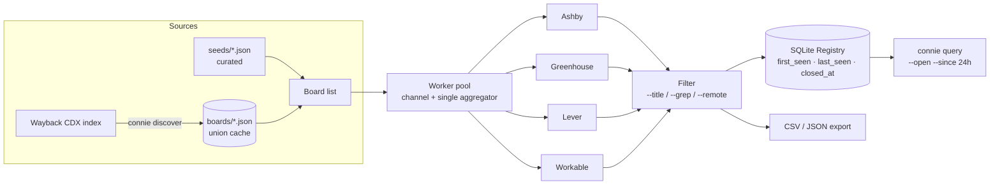

# connie

**The Circus's memory for public job boards.**

Connie scans the free, unauthenticated APIs of four applicant-tracking
systems — **Ashby, Greenhouse, Lever, and Workable** — filters the postings you care
about, and *remembers every posting she has ever seen* in a local SQLite
Registry: `first_seen`, `last_seen`, and a careful `closed_at` lifecycle.
Run her on a schedule and the diff is a signal feed: **who started hiring
for what, the day it opened.**

Named for Connie Sachs of *Tinker Tailor Soldier Spy* — the researcher whose
head was the Registry. Sibling of [Merlin](https://pushtomain.xyz/work/merlin/)
and [Lamplighter](https://pushtomain.xyz/work/lamplighter/).

```
$ export CONNIE_CONTACT="you@example.com"     # goes in the User-Agent — be a good citizen
$ connie scan --title "revenue operations"
  35/35 boards
registry: 6 new, 0 updated, 0 closed (connie.db)
6 postings -> connie-jobs.csv, connie-jobs.json | 0 dead boards | 0 errors

$ connie query --open --since 24h --format table
ashby   render   Revenue Operations Manager   https://jobs.ashbyhq.com/render/...
```

## Why GTM teams care

A job posting is the cheapest, most honest buying signal there is: a company that opens a *Revenue Operations Manager* role is about to feel that pain, budget is already approved, and the date it opened is a natural reason to reach out ("saw you're building out RevOps").

Most tools show you postings that exist **today**. Connie tells you what **changed**: new postings with the day they first appeared, postings that vanished (role filled or cancelled), and postings that came back. That diff is what sales, recruiting-adjacent vendors, and agencies actually want, and it costs nothing but the free public ATS APIs.

Typical uses:

- **Outbound triggers:** "companies that opened a RevOps / Data Engineer / SDR role in the last 24h" pushed to a CRM or Slack.
- **Market maps:** which boards hire for a function, and how fast roles close.
- **Vendor timing:** hiring for a tool's admin role usually means the tool was just bought.

## Sample signal-feed workflow

```bash
export CONNIE_CONTACT="you@example.com"

# 1. Full unfiltered scan of the seed boards. Only --all runs may close postings.
connie scan --all --ats ashby,greenhouse,lever,workable

# 2. What opened in the last 24h that matches my ICP roles?
connie query --open --since 24h --title "revenue operations" --format json > new-signals.json

# 3. Turn it into a feed: one line per signal.
jq -r '.[] | "\(.board)\t\(.title)\t\(.location)\t\(.url)"' new-signals.json
```

Example output (illustrative; company names are placeholders):

```
acme-co     Revenue Operations Manager    Remote (US)   https://jobs.ashbyhq.com/acme-co/...
globex      Sr. RevOps Analyst            New York      https://boards.greenhouse.io/globex/...
```

From there pipe the JSON into your CRM importer, a Slack webhook, or a spreadsheet. The JSON schema is `ats, board, external_id, title, location, department, team, employment_type, remote, url, published_at, matched`.

## Architecture



## Install

```
go install github.com/saiwrd/connie@latest
```

Or build from a clone: `make build` — one static binary, `CGO_ENABLED=0`,
cross-compiles from anywhere (`make dist` targets linux/mac, amd64/arm64).

## Commands

```
connie scan     --title Q | --grep RE | --all    scan boards, filter, export, remember
connie discover [--ats ashby,greenhouse,lever,workable]
                                                harvest board slugs from the Wayback Machine
connie query    [--open] [--since 24h]           read the Registry offline
connie version
```

`scan` flags: `--ats`, `--exact`, `--remote`, `--limit N`, `--concurrency` (default 8),
`--timeout` (default 30s), `--out PREFIX`, `--db PATH`, `--no-db`.

- **`--title`** matches fuzzily in both directions: `"software engineer"` finds
  *Senior Software Engineer, Backend*, and a long query still finds the short
  title it contains. The reverse direction requires a multi-word title, so a
  long query can't drag in every posting titled just *Engineer*.
- **`--grep`** is a case-insensitive regex over posting *descriptions* (titles
  are `--title`'s job). Only matched context fragments are kept — full
  descriptions are ~95% of the payload and are never stored. Use `\b`
  boundaries: `--grep 'rust'` also matches *trust*.
- **`--all`** takes every listed posting, and is the only mode allowed to
  mark vanished postings closed (see lifecycle below).

## Where boards come from

Two files per ATS, by design:

- **`seeds/{ats}.json`** — committed, small, hand-curated and verified live.
  A fresh clone scans real boards with zero network discovery.
- **`boards/{ats}.json`** — gitignored. `connie discover` queries the Wayback
  Machine's CDX index for every archived board URL, shape-filters the noise,
  probes survivors against the live ATS, and unions the result with the seed
  and the previous cache. **The union never shrinks**, and the full crawl
  never turns this repo into a published customer list.

Heads up: Greenhouse's archive footprint is large — a full
`connie discover --ats greenhouse` can surface tens of thousands of
candidates and is best run overnight. Re-runs are safe and resumable by
construction (union semantics).

## The Registry lifecycle

Every posting is keyed `ats:board:external_id` and carries
`first_seen` / `last_seen` / `closed_at`. The rules are deliberately
conservative, and each is pinned by a test:

- Only an **unfiltered** (`--all`) run may close postings — a filtered run
  not seeing a job proves nothing.
- Closing is **scoped to boards the run actually scanned**; `--limit` and
  interrupted runs close nothing.
- A posting that reappears is **reopened**.
- Grep context from an earlier run survives later runs without `--grep`.

`connie query --since 24h --open` is therefore exactly "what's new since
yesterday" — the watch-mode primitive.

## Design notes (why it's built this way)

- **Why Go:** a scan is thousands of concurrent HTTP fetches. The pool in
  `internal/scan` is a plain channel worker pool where a single aggregator
  goroutine owns all mutable state — no mutexes in the package, proven by
  `go test -race`.
- **Why not `errgroup`:** its cancel-on-first-error semantics are exactly
  wrong here — one dead board must never abort a 3,600-board scan. Errors
  are counted, not propagated.
- **Why `modernc.org/sqlite`** (the only direct dependency): pure Go means
  `CGO_ENABLED=0` and a genuinely static, trivially cross-compiled binary.
  Its write-speed penalty vs the CGO driver is irrelevant at one
  transaction per scan. Cost: transitive `modernc.org/*` packages and a
  bigger binary — a fair trade for `GOOS=linux go build` just working.
- **404 is a fact, not a fault:** `ErrNotFound` never retries, dead boards
  self-prune from the discovery cache (never from seeds), and a failed
  *probe* is tolerated — union semantics mean nothing is lost either way.
- **The User-Agent is always pure ASCII.** An em-dash in a UA header once
  broke a predecessor's latin-1 header encoding. The sanitizer has a
  regression test.
- **Descriptions are fetched only when `--grep` needs them** (Greenhouse's
  `?content=true` roughly doubles the payload), and only the matched
  fragments survive into the Registry.

## Testing

```
make check    # gofmt, go vet, go test -race ./...
```

Everything runs offline against recorded fixtures — trimmed captures of one
real API response per ATS, never full crawls. One live smoke test exists
behind a build tag:

```
CONNIE_CONTACT="you@example.com" go test -tags live ./ats/smoke -v
```

## Etiquette (short version)

This scrapes public, unauthenticated APIs that ATS vendors provide so
postings can be shared. Be worthy of that: set `CONNIE_CONTACT`, keep
`--concurrency` at the default 8, and don't run discovery in a loop.

## Run it on a schedule (GitHub Actions)

The Registry is a single SQLite file, so a scheduled job only needs to persist that file between runs. This example caches it and posts new signals to a Slack incoming webhook. Save as `.github/workflows/signal-feed.yml` in your own repo:

```yaml
name: signal-feed
on:
  schedule:
    - cron: "0 14 * * 1-5"   # weekdays, 07:00 Pacific
  workflow_dispatch:

jobs:
  scan:
    runs-on: ubuntu-latest
    env:
      CONNIE_CONTACT: ${{ secrets.CONNIE_CONTACT }}   # goes in the User-Agent
    steps:
      - uses: actions/setup-go@v5
        with:
          go-version: stable
      - run: go install github.com/saiwrd/connie@latest

      - name: Restore Registry
        uses: actions/cache@v4
        with:
          path: connie.db
          key: connie-registry-${{ github.run_id }}
          restore-keys: connie-registry-

      - name: Scan
        run: connie scan --all --out feed

      - name: New in the last 24h
        run: connie query --open --since 24h --format json > new.json

      - name: Post to Slack
        env:
          SLACK_WEBHOOK: ${{ secrets.SLACK_WEBHOOK }}
        run: |
          n=$(jq length new.json)
          if [ "$n" -gt 0 ]; then
            text=$(jq -r '.[] | "• \(.title) @ \(.board) <\(.url)>"' new.json)
            jq -n --arg t "*$n new postings*"$'\n'"$text" '{text: $t}' \
              | curl -fsS -X POST -H 'content-type: application/json' --data @- "$SLACK_WEBHOOK"
          fi
```

Note: `connie scan` and `connie query` read/write `connie.db` in the working directory by default (`--db` to change it).

## Rate limits and ethics

- Connie only calls the **public, unauthenticated job-board APIs** that ATS vendors expose so postings can be syndicated. No logins, no scraping behind auth, no candidate data.
- Set `CONNIE_CONTACT` so board owners can reach you; it is placed in the User-Agent.
- Default concurrency is 8; 429 and 5xx responses retry with exponential backoff, 404 never retries. Please don't raise concurrency to "go faster".
- Don't run `connie discover` in a loop; the Wayback Machine and the ATS vendors are shared infrastructure.
- Postings are business information about companies, not people. If you enrich with contact data downstream, follow the laws that apply to you (CAN-SPAM, GDPR/ePrivacy, CASL, TCPA) and honor opt-outs.
- The committed `seeds/` are small and hand-verified on purpose; the full crawl output (`boards/`) is gitignored so this repo never becomes a published customer list.

## Lineage

The Ashby scan semantics — the fuzzy-match rules, the seed/cache split, the
closed-at lifecycle — are ported from
[mherzog4/ashbyhq-jobs](https://github.com/mherzog4/ashbyhq-jobs), a
single-file Python tool whose README documents six behaviors that look like
bugs and are load-bearing. They survived the rewrite; so did the tests.

## License

[MIT](LICENSE) © Joel Martinez · built at [pushtomain.xyz](https://pushtomain.xyz)
